# AutoBid LK — UI audit and design directions

Date: 2026-10-10, Asia/Colombo. Scope: redesign stages 1–2 within Phase 2; no application implementation. Existing uncommitted work preserved.

## Outcome

The UI is readable and restrained, but its hierarchy makes it feel like a pre-launch marketing template. The main opportunity is to bring vehicle discovery forward, simplify unavailable choices, and give photos and asking prices a more deliberate layout. Changing green or border radius alone will not solve this.

## Audit evidence and step health

Screenshots below were captured in this audit run using user-authorized isolated Chrome/Playwright. Normal screenshots reflect the pre-existing production build. Populated screenshots use the existing loopback PostgreSQL/RLS fixture and synthetic listings; these are not real vehicles or a provider acceptance test.

1. **Homepage — needs hierarchy work.** A large headline and description precede search on mobile. Three unavailable categories share equal area with the only supported category. Recently added vehicles start far down the page. Good: labelled search, plain-language copy and no fabricated activity. Move search directly beneath a concise heading, replace unsupported category tiles with a small availability note, and shorten the empty section. Keep category=car browsing functional.

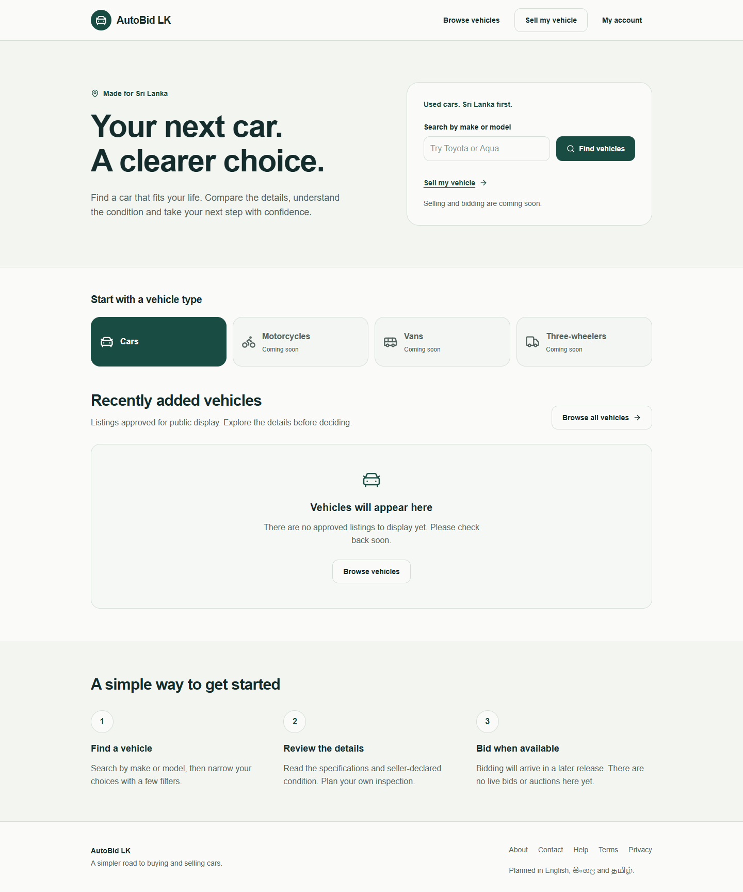
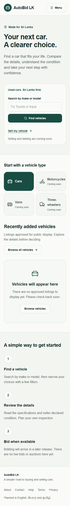

2. **Browsing and cards — functional, needs density and recovery work.** Search, URL filters, sorting and prices are discoverable. The desktop price placeholders clip within narrow half-width inputs. Mobile puts search, filter count, filter trigger, results count and sort controls in separate vertical groups before the first result. Each card combines a photo, multiple metadata rows, a price divider and a full-width action, making comparison slow on mobile. Empty browsing offers another Browse vehicles action that returns to the same screen; use appropriate recovery guidance instead. Keep explicit sort submission unless a behavior change is separately approved.

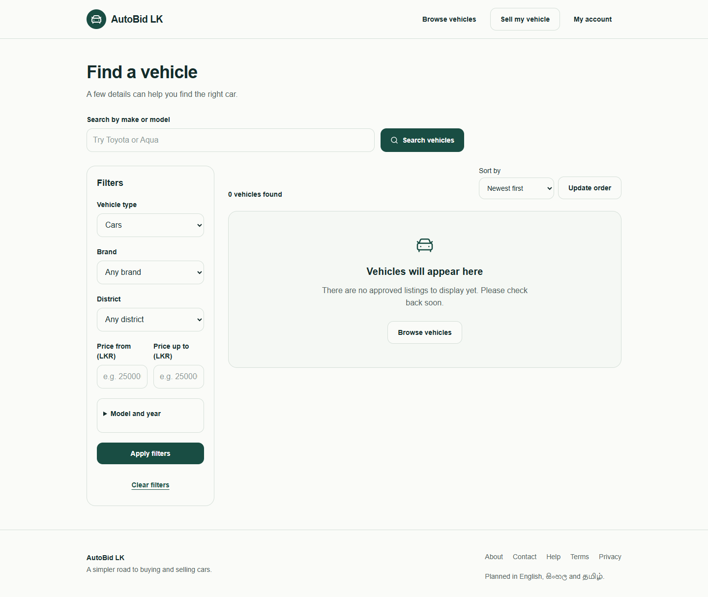
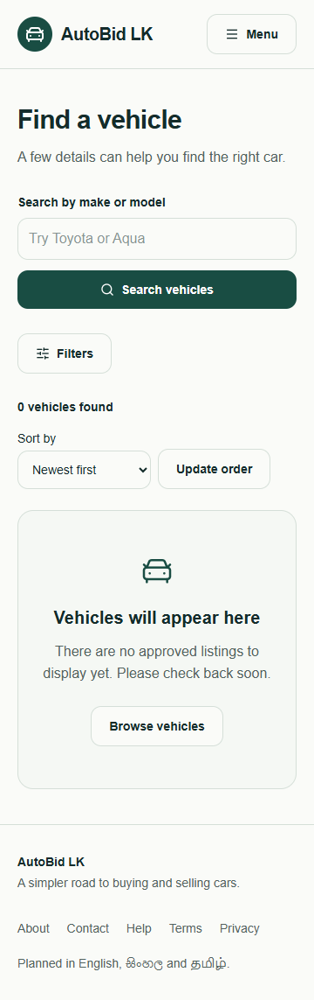
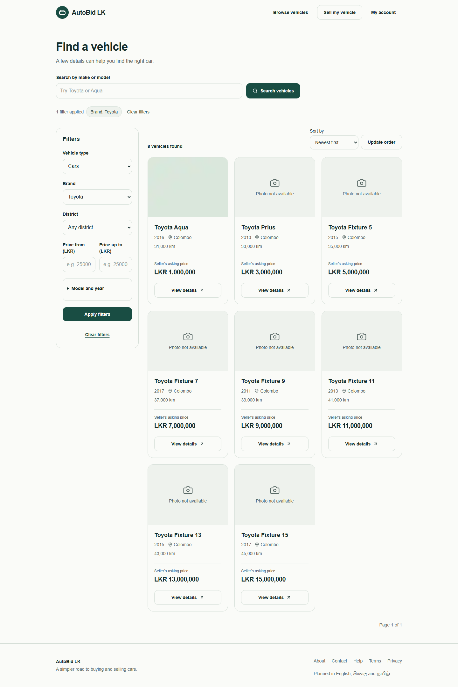
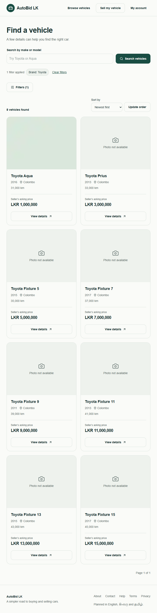

3. **Mobile navigation and filters — useful foundation.** Large labelled navigation actions and a simple modal are understandable. Filter Escape dismissal and trigger focus restoration passed. The single supported vehicle-type select is redundant. Keep make, district and price prominent; keep model/year disclosed on demand. Ensure the close control, expanded fields, keyboard opening and smaller-height screens receive explicit checks during implementation.

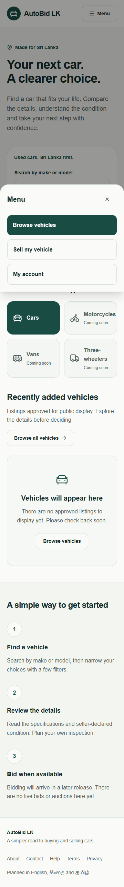
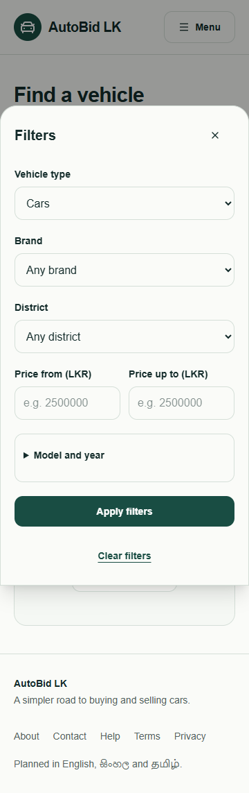

4. **Vehicle details — clear disclosure, needs stronger essentials.** Gallery, make/model and asking price are present. Mileage, fuel and transmission sit below the main summary. Price occupies a separate bordered box while the bidding-unavailable box has comparable prominence. Bring essential specifications into the summary and render availability as concise information. Do not invent a bid, contact seller, buy now, save or inspection action. Photo selection passed. The fixture raster is a plain test image; it cannot demonstrate vehicle photography or cropping quality.

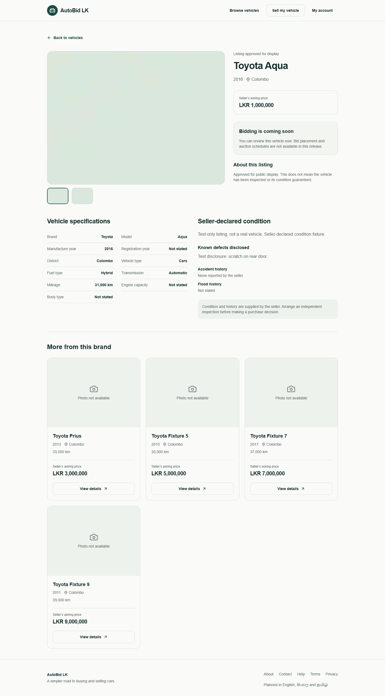
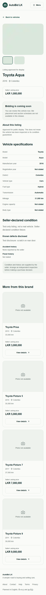

5. **Sign-in and registration — simple, mostly healthy.** Visible labels and minimal fields support comprehension. The registration title is vague and wraps into a large two-line introduction. Sign-in copy only mentions viewing the homepage despite public browsing being available. Use direct titles and reassuring browsing copy; retain existing Auth fields/actions and validation. Forms were viewed, not submitted; no accounts or emails were created.

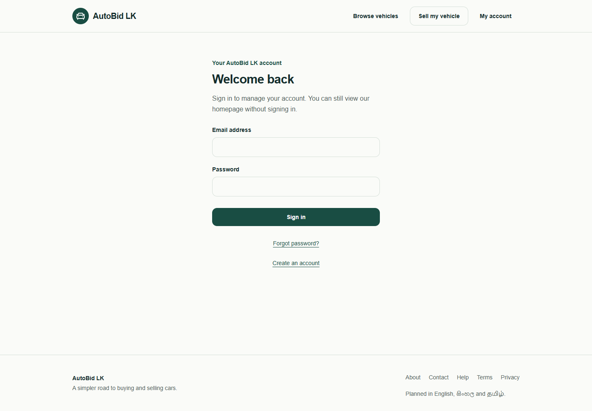
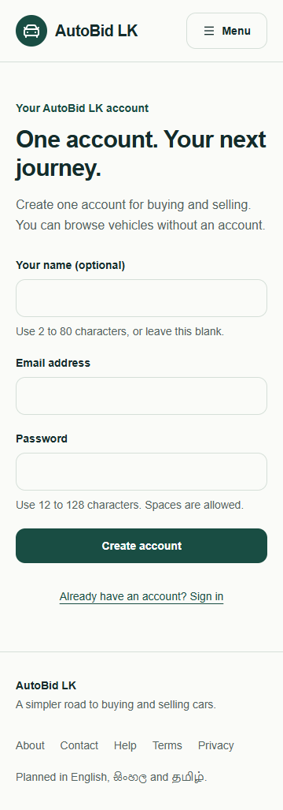

6. **Seller information — honest, entry label needs clarity.** Sell my vehicle leads to a coming-soon page. Indicate availability before the user clicks. The five planned stages exist as prose, not a working wizard. A later visual redesign may clarify these stages, but Phase 3 business functionality is outside this task.

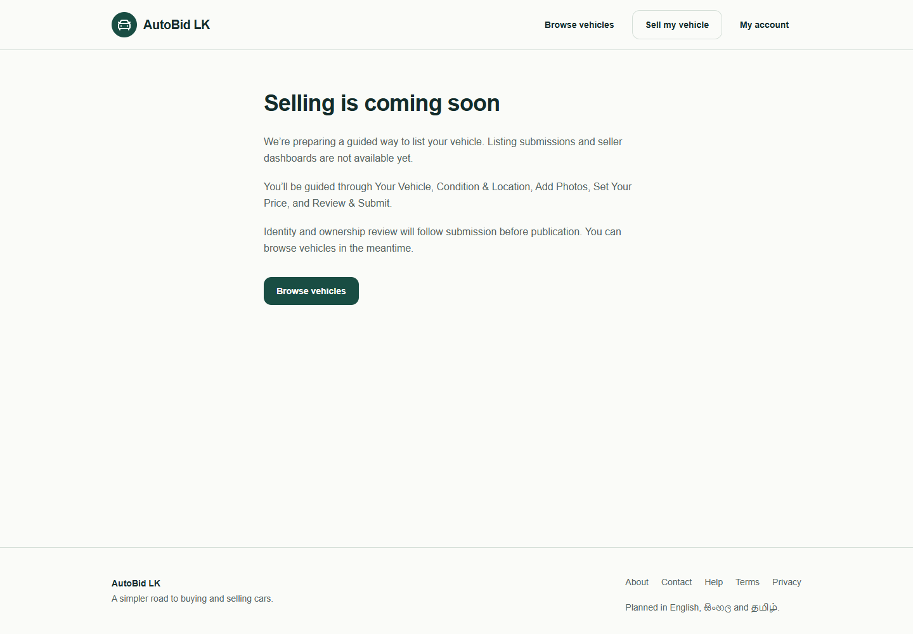

7. **Unavailable detail recovery — safe response, generic recovery.** Unknown detail returned HTTP 404 at all five widths. The current message links home; a vehicle-specific unavailable message with Back to vehicles would restore discovery more directly.

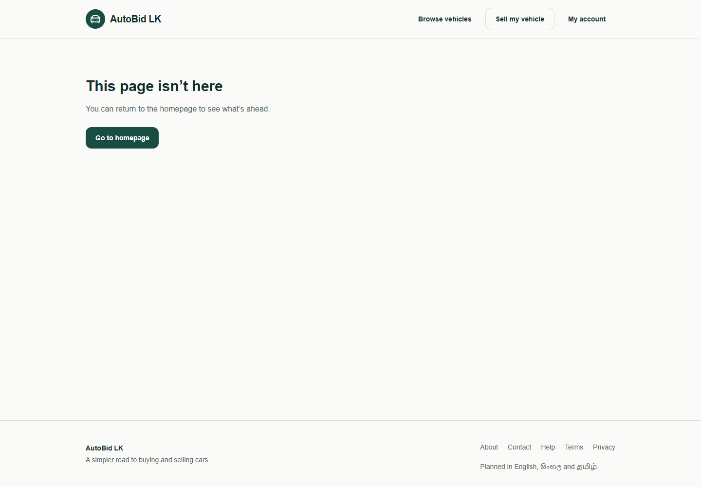

## Accessibility and evidence limits

- No horizontal overflow in 45 route/viewport observations: six normal routes and three fixture routes at 360, 390, 768, 1280 and 1440px.
- No pageerror events in either capture run. This does not assert absence of every browser console warning or a full accessibility audit.
- Verified search URL navigation; filter Escape/trigger focus restoration; gallery photo-2 pressed state. JSON records are normal-checks.json and fixture-checks.json.
- Both isolated fixture and restored normal production builds passed compilation and TypeScript. Local servers and fixture database closed; existing next-env.d.ts content restored exactly.
- Lint, the full Vitest/RLS suite, db:types:check and full E2E suite were not rerun: application code, migrations and dependencies were unchanged. The captures are focused audit checks, not complete regressions.
- No successful provider Auth, screen-reader test, zoom audit, real-device/network benchmark, full contrast/control measurement or Sinhala/Tamil rendering test was completed.
- English is the only available locale. Proposed font stacks and wrapping rules prepare future translations; no untranslated language selector should be introduced.
- Normal capture showed zero approved listings. This is an observation of that local build, not verification of the live database or resolution of the documented provider acceptance gaps.

## Three proposed directions

Generated homepage images are design concepts, not implemented pages. Illustrative vehicle imagery is not an actual listing and would require an approved source before use. All directions retain the current public search boundary, supported used-car scope, English-only availability and future selling/bidding disclosures.

| Aspect | Premium Automotive Minimalism | Modern Automotive Editorial | Contemporary Local Marketplace |
| --- | --- | --- | --- |
| Palette | Background #F8F9F7; surface #FFFFFF; text #162027; primary #126657; gold #D99A43; muted #5B6770; border #E0E5E2 | Light ivory #F6F5F1, white, graphite/navy #192B39, muted slate #586772, restrained ochre #B17B39 | White, soft neutral #F4F7F4, charcoal #20302B, accessible green #216345, muted #59665E, borders #DCE4DE |
| Typography | Geist/Inter-style sans; 16px body, 14px supporting text, 32–44px home heading, 24–28px price | Confident sans with editorial 40–48px desktop heading; 16px body, clear numeric prices | Familiar sans; 28–36px heading, 16–18px body and labels, 24px price |
| Layout | Calm split composition; concise search-led left column, restrained illustrative automotive photo right; recent section and short explanatory row | Asymmetric magazine grid, light page with graphite structural areas; panoramic automotive image, separate prominent search strip | Search-first utility layout; brief introduction, large search controls, direct browse route and compact help rows |
| Vehicle cards when real data exists | 4:3 approved photo; make/model, year/location/mileage in two concise rows; prominent asking price; one clear details route; 8px radius and subtle border | Wider photographic proportions; editorial alignment, thin separators, prominent price with minimal boxing | Straightforward image, bold title and price, familiar metadata, large View details target; compact one-column mobile comparison |
| Navigation | Brand, Browse vehicles, My account; secondary Selling information with coming-soon context | Minimal masthead and separated navigation; no editorial content destination unless implemented | Direct Find vehicles and account entry; labelled menu on small screens; selling availability explicit |
| Mobile | Search stays above illustrative photo; photo may shorten or move below results; single-column cards; filter drawer | Search precedes imagery when stacked; shorter heading and crop; no horizontal editorial carousel | Search first; controls stack without squeezing; filter drawer and compact results toolbar; no extra bottom overlay |
| Strength | Best combination of professional identity, readable hierarchy and restrained automotive character | Most distinctive art direction and strongest photography presentation | Fastest to understand and easiest to scan for first-time users |
| Weakness | Can become bland without disciplined photo selection and type hierarchy | Large imagery can push search down; needs careful mobile handling and image-performance budgets | Can resemble ordinary classifieds if typography and vehicle photography are weak |

**Recommendation: Premium Automotive Minimalism**, using the practical search placement and compact mobile comparison from Contemporary Local Marketplace. The selected screenshot palette suits the product; apply gold sparingly to non-text accents, never white small text on gold. Photo quality and search hierarchy should carry the identity.

Shared implementation intent after selection: no new project, dependencies, schema, Auth behavior or business workflows; keep feature components and typed dictionaries; improve semantic tokens and spacing within existing routes. Use Noto Sans Sinhala/Tamil as future script-specific fallbacks only when translated content is actually authorized and reviewed. Concepts do not demonstrate multilingual readiness.

## Stop point at the end of the audit

The audit stopped after direction exploration, before source changes. The user subsequently selected option 1; its implementation is recorded in ../redesign-2026-10-10/implementation.md and the root design-qa.md. Phase 3 remains unauthorized. No commit, push, deployment or live database mutation.

## Generated concepts and selection mapping

Built-in Image Gen produced the following three independent concepts, in this displayed order. Current desktop/mobile homepage captures were attached to every call; the supplied palette's exact values were included as text in the Premium prompt. These are raster design studies, not working interfaces or actual listing photographs.

1. Premium Automotive Minimalism — recommended. Search and illustrative vehicle photo share the first section; concise category availability and an explanatory row follow.

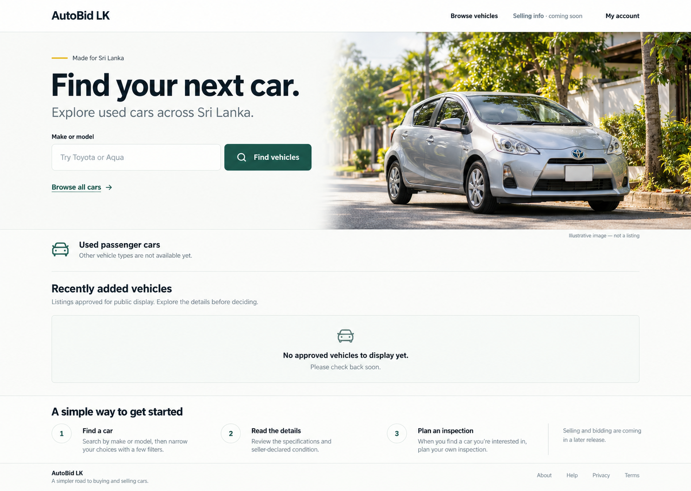

2. Modern Automotive Editorial. Navy masthead, strong editorial title, panoramic photo and ruled horizontal search strip.

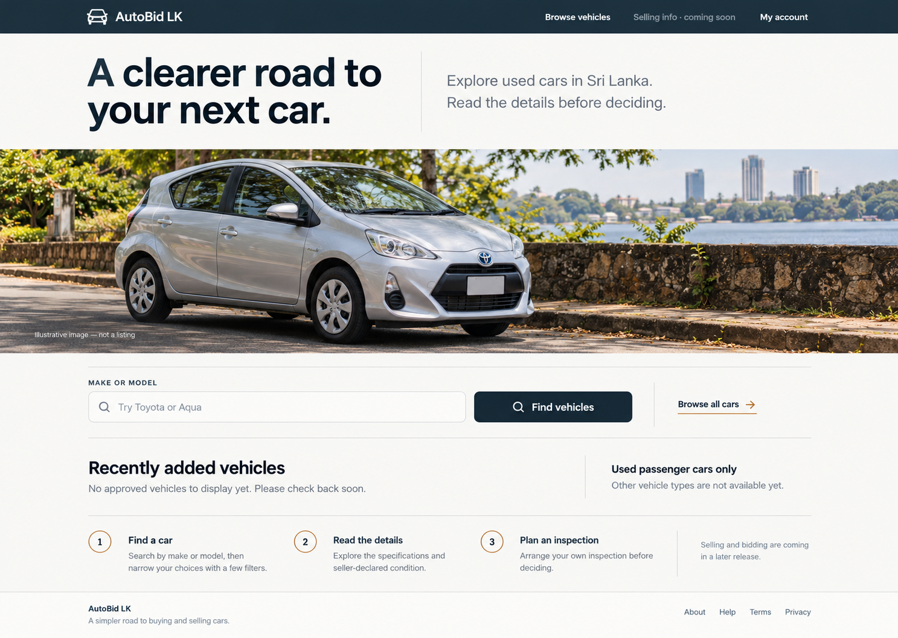

3. Contemporary Local Marketplace. Familiar search-led presentation, browsing reassurance and an adjacent New here help block.

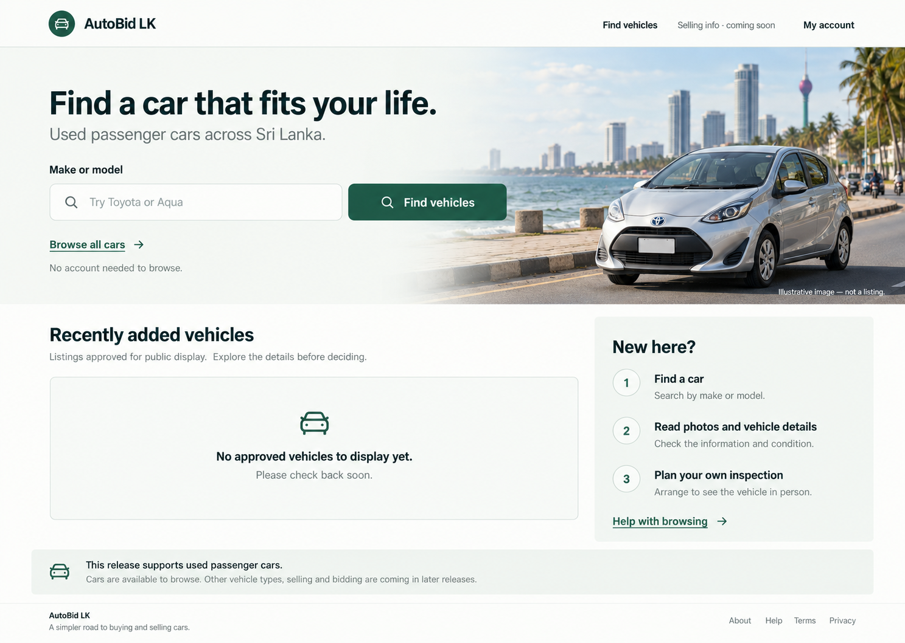

### Concept review limits

The generated images were inspected. Their desktop composition is a visual direction, not pixel-accurate token/font implementation. They retain the empty catalog and distinguish illustrative photography from listings. Mobile behavior in the comparison table is proposed, not rendered/verified for these concepts. The third concept converged toward the first concept's photo/search hero more than the intended full-width search-first layout; its distinct element is the adjacent help structure. If selected, refine the search hierarchy before implementation. Its generated availability banner also says Cars are available to browse beside the empty catalog; replace that line with Browsing is available; approved listings will appear here before using the design. Generated fade effects should resolve to clean separate photo/surface boundaries in the final selected design, consistent with the no-gradient brief.

No generated image is installed into the application. Only design-report, screenshot/check records and concept artifacts were added. Application source, dependencies, database contracts and existing uncommitted changes were preserved.
